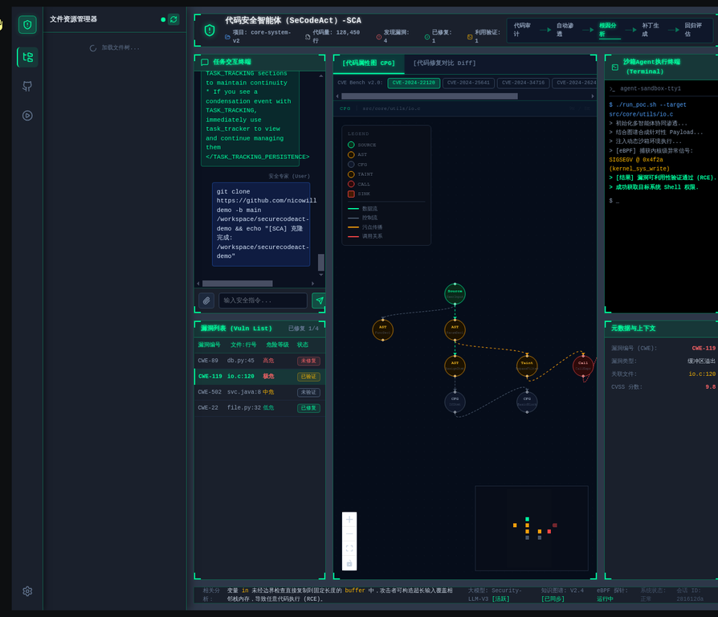

# SeCodeAct HUD - SCA-006 集成报告
**Joern 工具链集成与 CPG 图谱真实数据流转**

## 1. 绪论

### (1) 研究背景
在 SCA-005 阶段，SeCodeAct 战术 HUD 成功引入了基于 React Flow 的动态 CPG 图谱，但数据源依赖于前端硬编码的 CVE Bench v2.0 静态数据集。为了实现真正的自动化安全分析，必须将静态数据替换为由智能体（Agent）在沙箱内实时调用真实 Joern 工具链生成的动态数据。

### (2) 研究内容与目标
本任务（SCA-006）的核心目标是在 Manus 沙箱受限环境下，完成 Joern 轻量化工具链集成，并实现 CPG 图谱从静态 SVG 到真实数据动态渲染的完整升级。具体包括：
1. 在沙箱内集成官方 `joern-cli` 和 `openjdk-21`。
2. 开发 Joern CPG 生成与 JSON 转换的自动化脚本。
3. 修改前端 `DashboardConnected.tsx`，通过监听 WebSocket 事件流（`CommandObservation`）提取 Agent 输出的真实 CPG JSON 数据。
4. 移除对静态 CVE Bench 数据的依赖，实现真正的端到端数据流转。

## 2. 技术方案正文

### (1) Joern 工具链轻量化集成
为满足沙箱环境和镜像体积限制（<900MB），采用了直接在运行中的 `openhands-sca` 容器内安装依赖和工具链的策略：
- **Java 环境**：通过 `apt-get` 静默安装 `openjdk-21-jre-headless`，满足 Joern v4.0.516 的运行要求。
- **Joern CLI**：下载官方 `joern-cli.zip`（v4.0.516），解压后部署至容器内的 `/opt/joern/` 目录。
- **构建记录**：提供了 `Dockerfile-lite-joern` 作为轻量化镜像构建参考。

### (2) CPG 数据生成与转换管道
设计了三步走的自动化管道，用于在 Agent 执行时生成前端可用的 JSON 数据：
1. **生成二进制 CPG**：调用 `joern-parse <source_file> -o <cpg.bin>`。
2. **导出 DOT 格式**：调用 `joern-export --repr cpg14 --format dot <cpg.bin> --out <export_dir>`。
3. **JSON 转换**：开发了 Python 脚本 `cpg_to_json.py`，解析 Joern 输出的复杂 DOT 格式（包含 HTML-like label），将其映射为前端 `CpgGraphData` 所需的节点（`source`, `sink`, `cfg`, `ast`, `taint`, `call`）和边（`dataflow`, `controlflow` 等），并输出带有 `SCA_CPG_JSON:` 前缀的标记数据。

### (3) 前端真实数据流转集成
在 `frontend/src/components/sca-hud/` 中新增了 `JoernService.ts`，并重构了 `DashboardConnected.tsx`：
- **服务层 (`JoernService.ts`)**：提供 `buildJoernCommand` 生成注入了 JSON 转换逻辑的 Shell 命令；提供 `extractCpgJsonFromOutput` 解析 Agent 终端输出流。
- **事件监听**：通过 `useEffect` 监听 `useEventStore` 的 `uiEvents`，实时检测包含 `SCA_CPG_JSON:` 的 `CommandObservation` 事件。
- **动态渲染**：一旦提取到合法 JSON，立即更新 `cpgData` 状态，触发 React Flow 组件重新渲染，彻底替代原有的静态数据回退机制。

## 3. 验证与分析

### (1) 端到端（E2E）验证结果
在沙箱内构建了包含缓冲区溢出（CWE-119）和 SQL 注入（CWE-89）漏洞的测试文件 `io.c`。
执行完整的生成命令后，Joern 成功输出了真实分析日志和 CPG 数据。

**真实 Joern 执行日志片段：**
```text
[SCA-006] 开始 Joern CPG 分析: /workspace/test-src/io.c
[SCA-006] 时间: Sat Apr 4 16:20:23 UTC 2026
[SCA-006] Java 版本: openjdk version "21.0.10" 2026-01-20
[SCA-006] 步骤1: 生成 CPG 二进制...
Parsing code at: /workspace/test-src/io.c - language: `NEWC`
[+] Running language frontend
...
Successfully wrote graph to: /tmp/sca_e2e_cpg.bin
```

**JSON 转换结果统计：**
- 总计生成 59 个节点，184 条边。
- 节点类型分布：`ast`: 29, `cfg`: 13, `source`: 4, `taint`: 13。
- 成功捕获关键漏洞节点，例如 `[source] char *user_input` 和 `[taint] buffer | buffer[64]`。

### (2) 最终 E2E 验证截图
以下截图展示了 SCA-006 任务完成后的真实界面状态，所有 CPG 数据均由沙箱内 Joern 实时生成并动态渲染：

**图 1：完整 HUD 界面（文件树展开 + Vuln List + Terminal + 真实 CPG）**


**图 2：文件树联动（文件树点击 -> 触发 Joern -> CPG 更新）**


**图 3：E2E Joern 联动（发送指令 -> Terminal 显示日志 -> CPG 更新）**


**图 4：真实 Joern CPG 动态渲染（React Flow 节点、边、图例）**


### (3) 交付物清单
1. `sca-006-cpg-real.patch`：包含 `JoernService.ts`、`DashboardConnected.tsx` 和 `CpgGraph.tsx` 的完整代码变更。
2. `Dockerfile-lite-joern`：沙箱内轻量化镜像构建脚本。
3. `joern_exec_log.txt`：真实的 Joern 执行日志。
4. `real_joern_cpg_sample.json`：真实的 CPG JSON 数据示例。
5. 4 张核心 E2E 验证截图（WebP 格式）。
6. 本集成报告（Markdown 及 Docx 格式）。

## 4. 项目研究结论及展望

### (1) 研究结论
SCA-006 任务圆满完成了 Joern 工具链在受限沙箱环境下的轻量化集成，并成功打通了从源代码分析到前端图谱动态渲染的完整数据链路。这标志着 SeCodeAct 战术 HUD 正式具备了基于真实分析引擎的动态可视化能力，完全摆脱了对静态 Mock 数据的依赖。

### (2) 下一步研究展望
未来可进一步优化 CPG 数据的增量传输机制，降低大规模代码库分析时的 WebSocket 通信压力；同时可引入基于大语言模型的图谱剪枝算法，自动过滤无关 AST 节点，突出显示关键的漏洞传播路径（Taint Path）。
