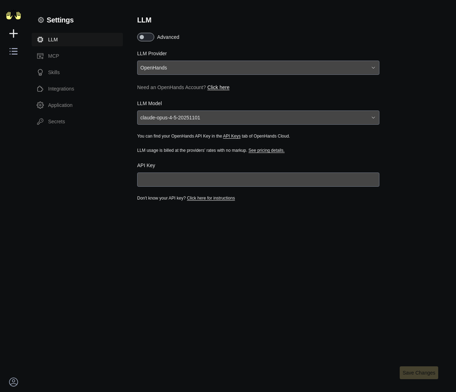
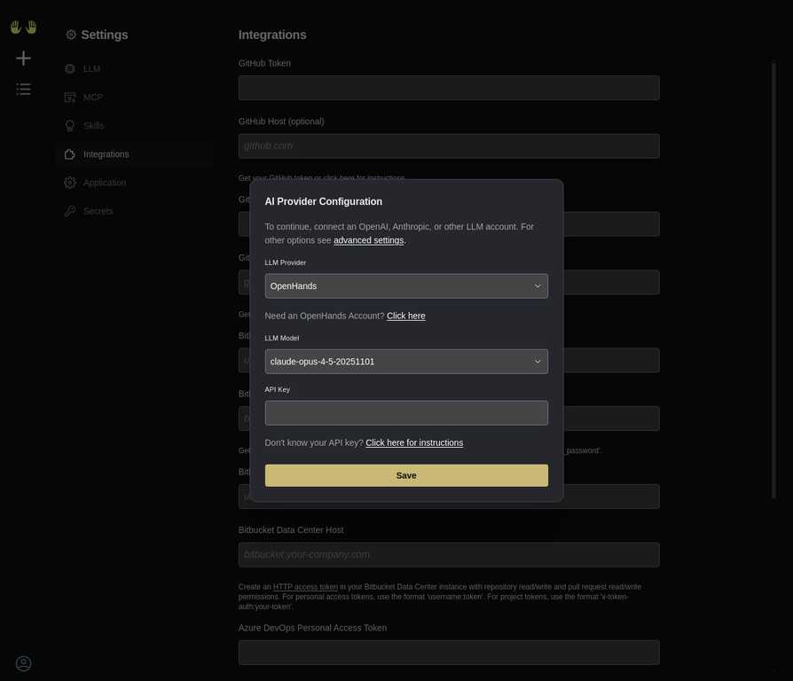
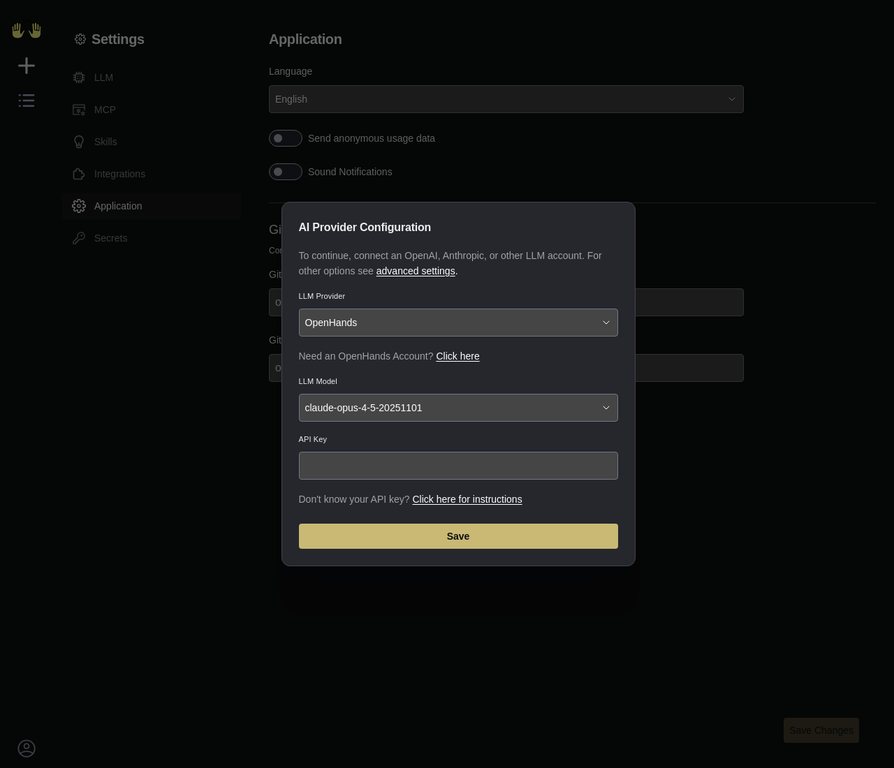
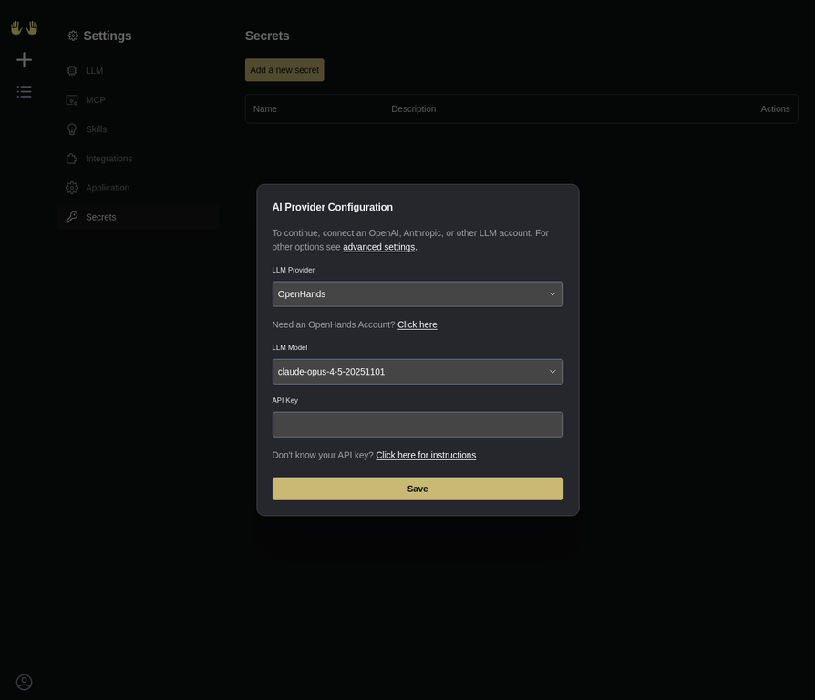

# SecureCodeAct (OpenHands) 系统使用手册

本手册旨在指导用户如何在本地启动和使用 **SecureCodeAct**（基于 OpenHands）系统。该系统是一个由大语言模型（LLM）驱动的自动化代码执行与开发代理（Agent）平台。

---

## (1) 系统简介

SecureCodeAct 是一个智能软件开发与安全分析代理系统。它通过一个独立的 Docker 沙箱环境（Sandbox Environment）安全地执行代码，并通过 Web 用户界面（Web GUI）与用户进行交互。用户可以向系统指派开发、调试或安全测试任务，系统会自动进行思考、编写代码、执行命令并返回结果。

---

## (2) 快速启动指南

在开始使用系统之前，需要确保您的机器上已安装了 Docker。本节将指导您如何使用官方预构建镜像快速启动系统。

### (2.1) 准备工作空间

系统需要一个本地目录来存储您的项目文件和代码。请在您的终端（Terminal）中执行以下命令创建工作空间和配置目录：

```bash
mkdir -p ~/.openhands
mkdir -p ~/oh-workspace
```

### (2.2) 启动系统容器

执行以下 Docker 命令启动 SecureCodeAct 容器。该命令会将容器的 3000 端口映射到本机的 3000 端口，并挂载刚刚创建的工作空间目录：

```bash
sudo docker run -d \
  --name openhands-app \
  --network host \
  -v /var/run/docker.sock:/var/run/docker.sock \
  -v ~/.openhands:/.openhands \
  -v ~/oh-workspace:/opt/workspace_base \
  -e SANDBOX_RUNTIME_CONTAINER_IMAGE=ghcr.io/openhands/runtime:0.47.0-nikolaik \
  -e LOG_ALL_EVENTS=true \
  ghcr.io/openhands/openhands:main
```

> **注意**：如果在启动过程中遇到网络桥接（Network Bridge）或 `iptables` 错误，请确保使用 `--network host` 参数以主机网络模式运行。

启动成功后，打开您的浏览器，访问 `http://localhost:3000` 即可进入系统界面。

---

## (3) 系统功能与界面导航

本节将详细介绍系统的各个核心功能模块及其界面布局。

### (3.1) 初始配置界面

首次访问系统时，会弹出一个“AI Provider Configuration”（AI 提供商配置）对话框。在这里，您需要配置驱动系统运行的大语言模型（LLM）。


在配置界面中，您需要填写以下关键信息：
- **LLM Provider（大语言模型提供商）**：选择您要使用的模型服务商，例如 OpenAI、Anthropic 或 OpenHands 官方提供的测试模型。
- **LLM Model（大语言模型型号）**：选择具体的模型版本，例如 `claude-opus-4-5-20251101` 或 `gpt-4o`。
- **API Key（应用程序编程接口密钥）**：输入您从服务商处获取的 API 密钥，用于授权系统调用模型服务。

填写完毕后，点击底部的“Save”（保存）按钮。

### (3.2) 系统主界面

完成配置后，您将看到系统的主界面。主界面采用了暗色主题（Dark Theme），设计简洁，主要包含左侧的导航栏和中间的操作区域。


在主界面中，您可以选择以下操作：
- **Open Repository（打开代码仓库）**：连接并打开一个现有的 GitHub 或 GitLab 代码仓库。
- **Start from Scratch（从零开始）**：创建一个全新的空白项目，直接向代理下达指令。

### (3.3) 系统设置中心

点击左侧导航栏底部的“Settings”（设置）图标（齿轮图标），可以进入系统的详细设置中心。设置中心包含多个子选项卡。

#### (3.3.1) LLM 设置

在“LLM”选项卡中，您可以随时修改您的模型提供商、模型型号和 API 密钥。如果您打开了“Advanced”（高级）开关，还可以配置基础 URL（Base URL）等高级参数。



#### (3.3.2) MCP 设置

“MCP”代表模型上下文协议（Model Context Protocol）。在此选项卡中，您可以配置外部的 MCP 服务器（MCP Servers），从而让系统能够访问更多的外部工具和数据源。点击“Add Server”（添加服务器）即可配置新的 MCP 服务。


#### (3.3.3) 外部集成 (Integrations)

“Integrations”（集成）选项卡允许您绑定各种第三方代码托管平台的访问令牌（Access Tokens），以便系统能够自动拉取代码、提交修改和创建合并请求（Pull Requests）。

支持的平台包括：
- GitHub
- GitLab
- Bitbucket
- Azure DevOps
- Forgejo



#### (3.3.4) 应用程序设置 (Application)

在“Application”（应用程序）选项卡中，您可以配置系统级别的首选项，例如：
- **Language（界面语言）**：设置界面的显示语言（例如 English）。
- **Git Username / Email（Git 用户名和邮箱）**：设置系统在自动提交代码时使用的 Git 签名信息。



#### (3.3.5) 机密信息管理 (Secrets)

“Secrets”（机密信息）选项卡用于安全地管理系统在执行任务时可能需要的敏感信息（如数据库密码、第三方 API 密钥等）。点击“Add a new secret”（添加新机密）即可将这些信息注入到代理的执行环境中。



### (3.4) 对话与任务执行界面

当您从主界面选择“Start from Scratch”或打开一个仓库后，系统会进入“Conversation”（对话）界面。


在这个界面中，您可以在底部的输入框中输入自然语言指令（例如：“编写一个 Python 脚本来扫描当前目录下的安全漏洞”）。发送指令后，系统将开始思考，并在界面上实时展示其执行的终端命令（Terminal Commands）、修改的文件（File Edits）以及思考过程（Thoughts）。

---

## (4) 常见问题与故障排除

- **问题：容器无法启动，提示端口冲突。**
  - **解决方案**：确保本机的 3000 端口未被其他程序占用。可以使用 `lsof -i :3000` 命令检查并关闭占用该端口的进程。

- **问题：代理执行命令时提示权限不足。**
  - **解决方案**：检查您挂载的工作空间目录（`~/oh-workspace`）的读写权限，确保 Docker 容器内的用户有权限对其进行操作。

- **问题：界面无法加载，显示空白。**
  - **解决方案**：检查浏览器的控制台是否有报错信息。如果是网络问题，请检查您的代理设置或尝试刷新页面。
