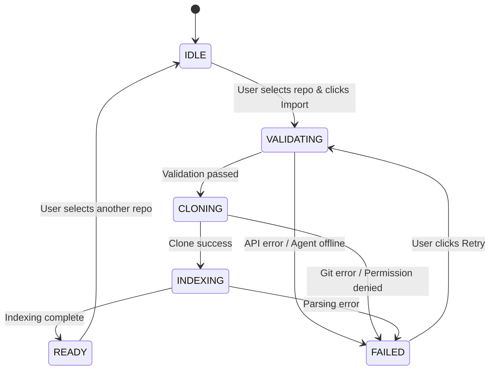

# SecureCodeAct: Repository Import State Machine

This document outlines the deterministic state machine implemented for the GitHub repository import process in SecureCodeAct.

## State Definitions

The `RepositoryImportState` type defines five mutually exclusive states:

1. **IDLE**: Initial state before user selects a repository.
2. **VALIDATING**: User clicked import; system is verifying repository access and agent status.
3. **CLONING**: Repository is being cloned into the agent's workspace.
4. **INDEXING**: Repository is cloned, and system is performing initial indexing (e.g., CPG generation, AST parsing).
5. **READY**: Import process fully completed. Agent is ready to accept commands against the imported codebase.
6. **FAILED**: Any step in the import process failed. An error message is preserved.

### READY State Strict Criteria (TC-SCA-REPO-IMPORT-API-005)

To ensure the "READY" state accurately reflects the sandbox's actual status (and not just a frontend state machine assumption), the transition to `READY` **must** eventually be gated by deterministic backend verification.

The hard criteria for `READY` include:
- **Workspace Verification**: The repository directory physically exists in the sandbox workspace.
- **Git Status**: `git status` executes successfully within the cloned directory.
- **File Readability**: At least one file in the repository tree is readable by the Agent.
- **Tree Synchronization**: The frontend file tree successfully refreshes and displays the cloned contents.

*Note: In the current iteration (TC-SCA-REPO-SANDBOX-USABILITY-004), READY is achieved via frontend orchestrator progression. The strict backend verification will be enforced in TC-SCA-REPO-IMPORT-API-005.*

## State Transitions

## UI Components

- **RepositoryImportPanel**: Renders the current state with visual indicators (spinners, checkmarks, error icons).
- **DashboardConnected**: Manages the state machine logic and orchestrates transitions based on API responses and Agent status.

## Error Handling

Errors are categorized using the `GitServiceError` classification to provide actionable feedback to the user:
- `UNAUTHORIZED`: Prompt user to configure `GITHUB_TOKEN`.
- `NOT_FOUND`: Prompt user to check repository permissions or URL.
- `NETWORK_ERROR`: Prompt user to check network connection.
- `UNKNOWN`: Display raw error message.

## Implementation Details

- **File**: `frontend/src/components/sca-hud/RepositoryImportPanel.tsx`
- **Type**: `RepositoryImportState`
- **Context**: Integrates with `AgentState` to ensure synchronization between-system consistency (e.g., Agent must be `INIT` or `RUNNING` before `VALIDATING` can proceed).
